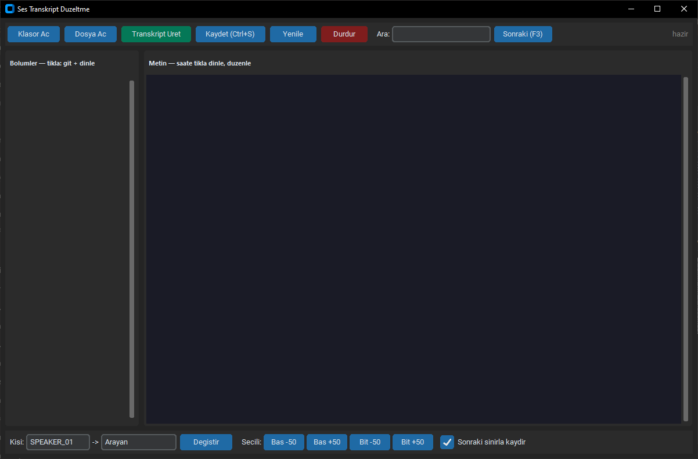

# Forensic TR — Turkish Phone-Call Transcription System

> [Türkçe sürüm](README-TR.md) | You are reading the English version.

End-to-end open-source pipeline that turns **real Turkish phone recordings into timestamped, speaker-separated, human-correctable transcripts** — and can be **fine-tuned on your own corrected data**. Tested and optimized for Turkish telephony audio (8 kHz narrowband, noisy, overlapping speech).

## Features

- **Transcription** — faster-whisper `large-v3-turbo` (default), `large-v3`, Turkish-fine-tuned models
- **Denoise shootout** — runs `raw` / `noisereduce` / `deep-filter.exe` branches on the same audio and scores them
- **Speaker diarization** — pyannote 3.1, timestamped output (`[00:00:24 - 00:00:51] SPEAKER_00: ...`) plus an **overlap report**
- **Correction GUI** (`editor.py`) — dark theme, click-to-listen, millisecond shifting with neighbor ripple, batch speaker renaming, built-in transcription dialog
- **Evaluation** (`score_wer.py`, `eval_models.py`) — WER/CER against a reference transcript, model-vs-model shootouts
- **Training** (`build_dataset.py` + `train_full.py`) — full fine-tuning on corrected recordings, CT2 conversion back into the pipeline

## Measured Results

Real 8.6-min Turkish phone call, faster-whisper large-v3-turbo, GPU:

| Variant | avg_logprob | Note |
|---|---|---|
| raw (recommended) | **-0.24** | Best balance |
| raw + loudnorm | -0.23 | Helps clipped recordings |
| noisereduce | -0.25 | No gain on clean audio, may eat quiet speech |
| deepfilter | -0.53 | **Not recommended** — clips speech on phone audio |
| condition_on_previous_text + beam 10 | -0.25, 7% speech lost | Not recommended, drops segments |

92-sec real recording, referee = human-corrected transcript (WER):

| Model | WER | CER |
|---|---|---|
| turbo (raw) | **0.247** | 0.166 |
| large-v3 | 0.354 | 0.214 |
| BuzzASR/turkish (CT2) | 0.392 | 0.195 |
| noisereduce | 0.481 | 0.453 |
| deepfilter | 0.582 | 0.510 |
| **fine-tuned model (this data, 4.4 h)** | **0.194** | **0.118** |

> Overlapped speech inflates absolute WER (no single-channel model transcribes it); treat the table as relative ranking. A reference transcript is required for absolute accuracy (`score_wer.py`).

## Installation

Requires Python 3.12 64-bit + ffmpeg.

```bash
git clone <repo> && cd <repo>
python -m venv venv
venv\Scripts\activate        # Linux/macOS: source venv/bin/activate
pip install -r requirements.txt
```

For NVIDIA GPUs, install a CUDA PyTorch build:

```bash
pip install torch torchaudio --index-url https://download.pytorch.org/whl/cu126
```

The diarization model is gated (free, terms acceptance required):

1. Accept terms at [pyannote/speaker-diarization-3.1](https://huggingface.co/pyannote/speaker-diarization-3.1) (plus `segmentation-3.0`, `speaker-diarization-community-1`)
2. Create a read-only HF token and export it for the first (online) run:
   `set HF_TOKEN=hf_...` (not needed on the offline target; copy models under `models/`)

## Quick Start

```bash
# Basic transcript (defaults: fine-tuned model + loudnorm + raw)
python code/transcribe_compare.py -i recording.wav --lang tr -o out

# With speaker diarization
python code/transcribe_compare.py -i recording.wav --diarize --speakers 2 --lang tr -o out

# Denoise comparison
python code/transcribe_compare.py -i recording.wav --denoise all --lang tr -o out

# Fine tuning knobs: hotwords, beam, VAD thresholds
python code/transcribe_compare.py -i recording.wav --hotwords Ankara,Istanbul \
  --beam 10 --vad-threshold 0.3 --min-silence 200 --speech-pad 400 --no-speech 0.8 -o out

# Model choice: turbo | buzz | large-v3 | e2 | CT2-folder-path
python code/transcribe_compare.py -i recording.wav --model large-v3 --lang tr -o out

# Score against a reference
python code/score_wer.py -r reference.txt -d out/
```

**GUI:**

```bash
python code/editor.py [folder | file.spk.txt]
```

Open a folder → pick a `.spk.txt` → click timestamps to listen → edit → `Ctrl+S`. Includes transcription dialog, speaker renaming, millisecond nudging, and overlap review.

## Training Your Own Model

1. Put corrected `.spk.txt` + audio pairs in data folders (`[hh:mm:ss.mmm - ...] 1.Şahıs: text` format — the editor produces it).
2. Build the dataset:
   ```bash
   python code/build_dataset.py            # everything
   python code/build_dataset.py --only E1  # subset
   ```
   Output: `dataset/train.jsonl`, `dataset/val.jsonl`, `dataset/wavs/`.
3. Train (RTX 3090 Ti, ~30–45 min):
   ```bash
   python code/train_full.py   # MODEL_DIR/OUT_DIR set inside the script
   ```
4. Convert to CT2 and plug it back in:
   ```bash
   ct2-transformers-converter --model models/whisper-tr-xxx --output_dir models/xxx-ct2 --quantization float16
   # + copy preprocessor_config.json and tokenizer.json (see training script)
   ```
5. Shoot out on the val set with `code/eval_models.py` and make the winner the default (`MODEL_ALIASES` in `transcribe_compare.py`).

Tips: stop after round 1 if val WER degrades (we observed overfitting from round 2 on); 1–2 epochs are enough for new domains; keep a held-out val set that mirrors deployment audio.

## Screenshots


*Listen - correct - save loop: click a timestamp, edit the text, `Ctrl+S`.*

## Project Layout

```
code/
  transcribe_compare.py  # main pipeline: denoise + VAD + whisper + diarization
  editor.py              # correction GUI (CustomTkinter)
  build_dataset.py       # .spk.txt + wav -> jsonl dataset
  train_full.py          # full fine-tuning (transformers Trainer)
  train_lora.py          # LoRA alternative (watch peft compatibility)
  eval_models.py         # model shootout on val set
  score_wer.py           # WER/CER against a reference transcript
requirements.txt
```

## Models & Licenses

This repo's own code is MIT-licensed. Models it uses have their own terms:

- Whisper large-v3 / turbo (OpenAI, MIT), BuzzASR/turkish (research — read its model card)
- pyannote diarization 3.1 (gated — accept terms on Hugging Face)
- faster-whisper (MIT), ctranslate2, torch, transformers (Apache-2.0)

Models are **not** included in the repo (see `.gitignore`); they download on first online run or are copied under `models/` for offline/USB deployment.

## Forensic Note

A transcript is supporting evidence; the recording itself is the evidence. Always verify critical passages by listening; overlapping speech (`*.overlap.txt`) always needs human review. Outputs are auto-backed-up (`*.bak-*`) and never silently overwritten.
